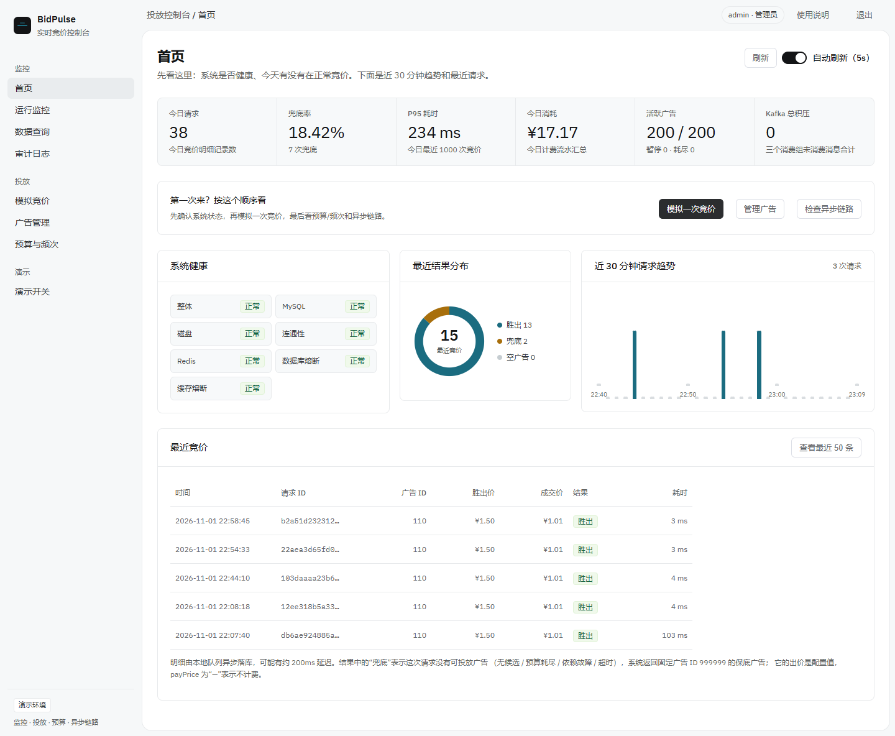

# BidPulse · 广告竞价投放

> **第一次阅读**：先看本文件的「零、这个程序是做什么的」和「四、快速开始」；想看代码结构直接跳 [`docs/architecture.md`](docs/architecture.md)。
> **文档入口**：[`docs/README.md`](docs/README.md) 按「先跑 → 结构 → 深挖」组织；根目录不再堆放多份长文档。
> **参与开发**：分支、测试矩阵、迁移与控制台写接口规则见 [`CONTRIBUTING.md`](CONTRIBUTING.md)。

**目录**：
· [这个程序是做什么的](#零这个程序是做什么的)
· [控制台预览](#控制台预览)
· [核心特性](#一核心特性) 
· [技术栈](#二技术栈) 
· [架构总览](#三架构总览) 
· [快速开始](#四快速开始) 
· [接口一览](#五接口一览) 
· [核心设计](#六核心设计) 
· [关键配置](#七关键配置) 
· [代码结构](#八代码结构) 
· [测试与 CI](#九测试与-ci) 
· [造数与压测工具](#十造数与压测工具) 
· [数据库与升级](#十一数据库与升级) 
· [边界与诚实标注](#十二边界与诚实标注)

---

## 零、这个程序是做什么的

BidPulse 是一个 **RTB（Real-Time Bidding，实时竞价）广告投放引擎** 的演示项目，
模拟 DSP / 媒体侧在一次广告曝光机会里的完整决策：**这次投不投、投哪条、收多少钱、失败怎么办、账怎么记**。

一次 `POST /bid` 大致经过：

1. **检索候选**：按地域、年龄、性别、类目从 MySQL 的 `ad JOIN ad_target` 中取候选，按出价降序取前 50；
2. **预算 + 频次裁决**：Redis 用一个 Lua 脚本原子判断「用户频次是否超限 → 预算是否足够 → 扣减 → 计数」；
3. **二价计费**：成交价 = `min(胜出价, 次高有效出价 + 0.01 元)`，预算不足的候选沿降序 fall-through；
4. **返回或兜底**：任何失败（无候选 / 预算耗尽 / Redis 或 DB 故障 / 超时）都返回兜底广告，不返回空广告；
5. **异步记账**：计费事件走 Kafka，三个消费组分别写账单、小时聚合、频次报表；竞价明细走本地队列批量落库；
6. **可恢复**：预算 key 丢失按账单重建、小时对账、消费失败指数退避 + DLT 重放。

它主要解决四类问题：

- **并发不超扣**：预算扣减放在 Redis Lua 里原子执行；
- **故障不空广告**：超时、熔断、依赖故障都收敛到三级兜底；
- **计费不丢账**：Kafka 至少一次 + `processed_event` 幂等 + DLT 重放 + 预算对账；
- **可演示、可排查**：独立控制台展示竞价、预算/频次、异步链路、数据表与运行时开关。

**它不是**：完整广告平台、生产级集群方案、真实广告主/素材审核系统。单实例、Kafka RF=1、Redis 未开持久化，
都是 demo 边界；控制台已带本地账号 token/RBAC 与审计，但未接 SSO/MFA，仍不建议直接公网暴露。

### 控制台预览



> 首页集中展示今日请求、兜底率、P95、消耗、健康/熔断、最近结果分布、近 30 分钟趋势和最近竞价。
> 其余页面（登录、模拟竞价、广告管理、预算与频次、运行监控、数据查询、演示开关、审计日志）见 `console-ui/README.md`。

## 一、核心特性

- **候选检索下推 SQL**：`ad JOIN ad_target` 多维求交，`ORDER BY bid DESC LIMIT 50` 全部在 SQL 内完成，热路径只回传竞价必需字段。
- **Redis Lua 原子扣减**：余额校验、扣减、累计消耗收进一个脚本，消除并发超扣；金额统一以「分」为单位，成交价显式量化到分。
- **实时频次控制**：请求可携带可选 `userId`，按「用户 × 广告 × 自然小时」限频（默认 3 次/小时）；频次校验与预算扣减合并在同一个 Lua 内一次原子裁决，超限只跳过候选，不扣预算、不计数、不误标耗尽；匿名流量整段短路，不增加 Redis 操作。
- **二价（Vickrey）计费**：成交价 = `min(胜出价, 次高价 + 最小加价)`；预算不足的候选自动 fall-through。
- **超时 + 分层熔断 + 兜底**：总预算 1000ms；DB 超时下沉到 `MAX_EXECUTION_TIME(800)` + MyBatis timeout；Redis 用 Lettuce 200ms；DB / Redis 各自独立熔断；任何失败收敛到兜底广告，绝不返回空。
- **Kafka 旁路不可丢**：`acks=all` + 幂等生产者 + 手动 ack；三消费组共用 `processed_event` 幂等去重，并用 SHA-256 载荷指纹区分「正常重投」与「同一 eventId 的恶意/错误改写」——同载荷跳过，不同载荷直接进 DLT，绝不覆盖已有账单；失败按 1s→2s→4s→8s→16s 指数退避（约 31s）后进入 `bid_event.DLT`；DLT 消息由定时任务限量重放回主主题（带重放次数头，超过上限留待人工）。
- **可丢明细异步落库**：竞价明细走本地有界队列，500 条或 200ms 批量刷盘，队列满直接丢，绝不阻塞主链路。
- **预算生命周期完整**：检索阶段预热 key、Lua 惰性播种、日预算复位、管理端改预算当天同步 Redis、历史 key 定时清理。
- **可观测**：Actuator 健康检查、Metrics、Prometheus；消费组 lag 查询接口。
- **决策轨迹可回看**：控制台发起的竞价会记录候选裁决（成交 / 余额不足 / 频次超限 / 需播种 / Redis 异常）、兜底原因与耗时分解，随明细异步落 `bid_log.trace_json`；外部 `/bid` 不采集，热路径零额外开销。
- **运维写幂等 + 前端 latest-wins**：DLT 重放、对账、暂停/恢复消费支持 `Idempotency-Key`（Redis `SET NX PX`，10 分钟窗口，重复 409）；控制台轮询改为不重叠 + 请求序号最新优先，超时未更新时明确标记「数据可能已过期」。
- **演示控制台（前后端分离）**：独立 `console-ui/`（Vue 3 + Vite + Element Plus），通过 `/console-api/v1` 展示概览、竞价结果、广告投放、预算/频次状态、Kafka/DLT/对账、数据浏览与运行时开关；后端不渲染页面。
- **工程纪律可执行**：ArchUnit 固化分层边界（热路径不依赖控制台、controller 不碰 SQL、DTO 不依赖服务层）；迁移命名 / `schema_migration` 记录 / README / baseline 种子由约定测试校验；生产代码禁止 `System.out` / `printStackTrace`；Maven Enforcer 校验 JDK 17+ / Maven 3.8+，`.gitattributes` 统一 LF。

---

## 二、技术栈

| 分类 | 选型 | 用途 |
|---|---|---|
| 语言 / 框架 | Java 17 · Spring Boot 3.2.5 | Web、配置、调度、事务 |
| 数据库 | MySQL 8.0 | 广告、定向、竞价明细、计费事件、聚合表 |
| 持久层 | MyBatis 3.0.3 | 手写 SQL，精确控制执行计划 |
| 缓存 | Redis 7 + Lettuce（commons-pool2） | 预算余额、Lua 原子扣减、兜底广告 |
| 消息 | Kafka 3.7 单节点 KRaft | 计费事件旁路、三个消费组、死信主题 |
| 熔断 | Sentinel 1.8.6（`sentinel-core`） | 慢调用比例熔断，可切回本地实现做 A/B |
| 可观测 | Actuator + Micrometer + Prometheus | 健康检查与指标出口 |
| 演示控制台 | Vue 3 · Vite · TypeScript · Element Plus | 前后端分离的演示 UI（`console-ui/`） |

---

## 三、架构总览

```
                         ┌──────────── 主链路（同步，SLA 1000ms）────────────┐
 流量方 ──POST /bid──► BidController ──► BidService
                                           │
                  ┌────────────────────────┼──────────────────────────────┐
                  ▼                        ▼                              ▼
        ① 候选检索（MySQL）     ② 预算扣减 + 频次控制（Redis Lua）  ③ 二价计费（Vickrey）
        ad JOIN ad_target          原子扣减 budget:{ad}:{date}        成交价 = min(胜出价,
        ORDER BY bid DESC          频次超限 → 下一个；余额不足 → 下一个   次高价 + 最小加价)
        LIMIT 50                   失败/超时 → 放弃剩余候选
                  │                        │
                  └────────────┬───────────┘
                               ▼
                    ④ 失败 / 耗尽 / 超时 ──► 兜底广告
                       Redis fallback:ad → 本地缓存（5s；失败退避 30s）→ 静态常量
                               │
                               ▼
                  返回 hasAd / winner / payPrice / fallback
                               │
               ┌───────────────┴────────────────┐
               ▼                                ▼
   Kafka bid_event（旁路，不可丢）       BidDetailBuffer（本地队列，可丢）
   acks=all + 幂等 + max.block.ms=100    容量 1 万，500 条或 200ms 批量刷盘
               │                                │
   ┌───────────┼────────────┐                   ▼
   ▼           ▼            ▼                 bid_log
hourly      billing      freq
preagg      recon        antifraud
   │           │            │
bid_stat    billing      ad_freq
hourly      event
   └───────────┴────────────┘
         processed_event(event_id, grp) 幂等去重
         指数退避 1s→16s → bid_event.DLT → 定时限量重放
```

### 数据分级（本项目最核心的取舍）

| 数据 | 通道 | 可靠性 | 说明 |
|---|---|---|---|
| `billing_event` 计费事实 | Kafka 旁路 | **不可丢**：至少一次 + 幂等去重 + 死信 | 涉及金钱，失败重试后进 DLT，绝不静默跳过 |
| `bid_log` 竞价明细 | 本地有界队列 | **可丢、可采样** | 队列满直接丢弃，绝不阻塞主链路 |
| `bid_stat_hourly` / `ad_freq` | Kafka 旁路 | 可从事件重放 | 小时聚合、离线频次报表（实时拦截由 Redis 承担） |
| 频次计数 `freq:u:*` | Redis | **可丢**：TTL 到期或 Redis 重启后计数清零 | 实时频控，只影响「是否继续投放」，不影响已发生的账 |
| `processed_event` 去重标记 | MySQL | 按保留期清理 | 三消费组共用，默认保留 8 天（须 ≥ Kafka retention） |

---

## 四、快速开始

### 1. 前置条件

- Docker Desktop（跑大规模造数/压测建议 ≥ 8GB 内存）
- JDK 17、Maven 3.9+

### 2. 启动中间件

```bash
docker compose up -d
docker compose ps      # bidpulse-mysql / bidpulse-redis / bidpulse-kafka 均为 healthy
```

> 容器名使用 `bidpulse-` 前缀；数据卷 key 为 `mysql-data-bidpulse` / `kafka-data-bidpulse`
> （`docker volume ls` 里实际显示为 `bidpulse_mysql-data-bidpulse` 等，前缀是 compose 项目名）。
> 服务使用独立的 `bidpulse` 数据库与数据卷，首次启动为空库，可直接建表 / 造数。
> 停止：`docker compose down`；连同数据卷删除：`docker compose down -v`。

### 3. 建表 + 演示造数

```bash
docker exec -i bidpulse-mysql mysql -uroot bidpulse < sql/all-schema.sql
docker exec -i bidpulse-mysql mysql -uroot bidpulse < sql/seed-demo.sql
```

- `all-schema.sql`：一次建好 8 张业务表 + `schema_migration` 记录表。脚本以 `DROP TABLE` 开头，**重跑会清空数据**，只用于全新库初始化/重置。
- `seed-demo.sql`：200 条广告 + 800 条定向条件，覆盖全部 **105 种「地域 × 年龄 × 性别」检索组合**（年龄 7 桶、性别含 `unknown`），保证任意请求都能命中候选，不会出现空广告。
- 重复灌数前先执行：`TRUNCATE ad_target; TRUNCATE ad;`。
- **存量库升级不要重跑 `all-schema.sql`**：按 `sql/migrations/` 下的版本顺序执行，规则见 [`sql/migrations/README.md`](sql/migrations/README.md)。

### 4. 启动应用

```bash
mvn spring-boot:run
# 或
mvn -DskipTests package && java -jar target/bidpulse-engine-0.1.0-M0.jar
```

默认端口 `8080`。

### 5. 验证

```bash
curl http://127.0.0.1:8080/actuator/health
curl -X POST http://127.0.0.1:8080/bid -H "Content-Type: application/json" \
  -d '{"slotCode":"slot-01","region":"110000","age":28,"gender":1}'
```

首次运行该示例会命中 2 个候选：`adId=110` 出价 1.50 胜出，次高价 1.00，成交价 `1.01`（`priceMode=1`）。

### 6. 演示控制台（前后端分离）

控制台源码在独立的 `console-ui/`，后端只提供 `/console-api/v1` REST 接口，不使用 Thymeleaf。

开发态两个进程分别启动：

```bash
# 终端 1：后端（8080）
mvn spring-boot:run

# 终端 2：前端（5173，/console-api 代理到 8080）
cd console-ui
npm install
npm run dev
```

打开 <http://localhost:5173/>。

控制台登录使用 Bearer token，角色分 VIEWER / OPERATOR / ADMIN。密码只从环境变量注入，不写入仓库：

```bash
BIDPULSE_AUTH_SECRET='<至少 32 字节的随机串>' \
BIDPULSE_ADMIN_PASSWORD='<管理员密码>' \
BIDPULSE_OPERATOR_PASSWORD='<操作员密码>' \
BIDPULSE_VIEWER_PASSWORD='<只读密码>' \
mvn spring-boot:run
```

未配置密码时，启动日志会生成一次性随机密码（仅本地演示）。登录接口为 `POST /console-api/v1/auth/login`，之后请求带 `Authorization: Bearer <token>`。存量库用 `sql/migrations/20261105_06_audit_log.sql` 补建 `audit_log`；缺失时审计只打应用日志，不影响业务。

单 jar 演示时把前端产物构建到后端静态目录：

```bash
cd console-ui
npm run build:embedded
# 打开 http://localhost:8080/console/index.html
```

控制台默认开启；登录/角色是主安全闸，`allow-write` 是控制台写操作的额外开关：

```yaml
bidpulse:
  console:
    enabled: true
    allow-write: true
    allowed-origins: "http://localhost:5173"
  auth:
    token-ttl-seconds: 28800
    # 密码只从环境变量注入
    users:
      admin:    { password: ${BIDPULSE_ADMIN_PASSWORD:},    role: ADMIN }
      operator: { password: ${BIDPULSE_OPERATOR_PASSWORD:}, role: OPERATOR }
      viewer:   { password: ${BIDPULSE_VIEWER_PASSWORD:},   role: VIEWER }
```

P0/P1/P2/P3 页面：概览、竞价实验室、广告与投放、预算与频次、Kafka 异步运维（含 DLT 浏览/重放、预算对账）、数据浏览、实验与开关、审计日志（ADMIN）。完整说明见 `console-ui/README.md`。

---

## 五、接口一览

### 竞价

| 方法 | 路径 | 说明 |
|---|---|---|
| POST | `/bid` | 一次竞价请求，返回胜出广告与成交价 |

请求体：

```json
{
  "slotCode": "slot-01",
  "region": "110000",
  "age": 28,
  "gender": 1,
  "categoryCode": "travel",
  "interests": "数码科技,游戏",
  "ageBucket": "25-30",
  "userId": "u-10086"
}
```

- `age` 与 `ageBucket` 二选一：显式传 `ageBucket` 时优先；只传 `age` 由服务端按 7 个桶换算。
- `gender`：1 男 / 2 女 / 0 或缺失 → `unknown`。
- `userId`（可选，≤ 64 字符）：传了才做实时频次控制；不传视为匿名流量，不读写频次 key。
- 响应统一为 `ApiResponse`：`code / msg / data / wallMs`；`data.priceMode` 为 0 一价 / 1 二价 / 2 兜底。

### 控制台竞价与轨迹

| 方法 | 路径 | 说明 |
|---|---|---|
| POST | `/console-api/v1/bids` | 与 `/bid` 同链路，额外返回 `data.trace` 并异步落库（OPERATOR） |
| GET | `/console-api/v1/bids/recent` | 最近竞价明细，`hasTrace` 标记该条是否可回看 |
| GET | `/console-api/v1/bids/{requestId}/trace` | 回看决策轨迹；`requestId` 为 32 位小写十六进制 |

轨迹包含 `outcome`（`WIN` / `FALLBACK` / `EMPTY`）、`fallbackReason`、候选裁决
（`SUCCESS` / `INSUFFICIENT` / `FREQ_CAPPED` / `NEEDS_SEED` / `REDIS_ERROR`）、时间线步骤与
`timings.dbMs / redisMs / totalMs`。候选最多保留 10 条，不记录用户标识等请求上下文。
明细异步刷盘（≤200ms），刚发起的竞价可能短暂 404，前端会延迟重试。

### 管理端

除 `POST /bid`、health/info、登录接口外，控制台与管理端均需要 Bearer token：
VIEWER 只读；OPERATOR 可执行控制台写操作；ADMIN 额外可写 `/admin/**`、读 Actuator 与审计日志。

| 方法 | 路径 | 说明 |
|---|---|---|
| POST | `/console-api/v1/auth/login` | 用户名/密码换 token |
| GET | `/console-api/v1/auth/me` | 当前用户与角色 |
| GET | `/console-api/v1/audit` | 审计日志（仅 ADMIN） |
|---|---|---|
| POST | `/admin/ad` | 新建广告（ad 与 target 同事务，至少 1 条定向） |
| GET | `/admin/ad/{id}` | 详情（含定向条件） |
| GET | `/admin/ad` | 列表：`?advertiserId=&status=&pageNum=&pageSize=` |
| PUT | `/admin/ad/{id}` | 更新（**全量替换**；`targets=null` 不动定向，`[]` 清空） |
| DELETE | `/admin/ad/{id}` | 删除（级联清定向） |
| PUT | `/admin/ad/{id}/status` | 上下架：`?status=1` 在投 / `?status=2` 暂停 |
| POST | `/admin/consumer/pause` | 暂停全部 Kafka 监听容器（模拟消费端故障） |
| POST | `/admin/consumer/resume` | 恢复监听 |
| GET | `/admin/kafka/lag` | 查询消费组积压：`?group=billing-recon` |

注意：

- 运维写接口（DLT 重放、单条重放、对账、暂停/恢复消费）支持可选的 `Idempotency-Key` 请求头：
  同一操作 10 分钟内重复提交返回 409；不带头则保持旧行为；Redis 不可用时 fail-open（记 warn 后继续执行）。
- `status=3`（已耗尽）是系统状态，不接受手工指定。
- 修改 `dailyBudget` 且事务提交成功后，会自动按「新日预算 − 今日已消耗」重算当天 Redis 余额，**当天生效**。
- 把 `status` 从 3 改回 1 本身不会重置预算；需要同时修改日预算（或等次日 00:05 复位任务）。

### 运维 / 可观测

| 路径 | 说明 |
|---|---|
| `/actuator/health` | 健康检查 |
| `/actuator/metrics` | 指标 |
| `/actuator/prometheus` | Prometheus 抓取端点 |

---

## 六、核心设计

### 1. 候选检索：把排序与限流下推 SQL

`ad JOIN ad_target` 按地域 / 年龄段 / 性别求交，`ORDER BY a.bid DESC LIMIT 50` 在 SQL 内完成。
`ad_target` 的 `idx_dim_lookup(dim_type, dim_value, ad_id)` 承担「筛得准」，热路径只回传竞价必需字段；
`ad` 表在检索路径上刻意不建索引（已有的 `idx_adv` 只服务管理端列表），用于保留全表扫描基线做性能对照。

### 2. 二价定价：金额口径统一到「分」

`PricingPolicy` 是纯函数：`成交价 = min(胜出价, 次高价 + 最小加价)`。
成交价在进入计费前显式 `setScale(2, DOWN)` 量化到分，保证「返回给调用方的 `payPrice`、写 Kafka/`bid_log` 的金额、Redis 实际扣减的分」三者完全一致。
预算不足的候选沿出价降序继续尝试（fall-through），不会因为一个广告没钱就整单流拍。
「次高价」取的是**有效出价** `min(候选出价, 当日剩余预算)`：`nextPayableBid` 用一次只读 `MGET`
批量取回窗口内（最多向后 5 条）竞争者的剩余预算，避免拿一个当天已耗尽的候选出价把成交价抬高；
价格随预算连续变化，不会因为差 1 分钱就从「按次高出价」跳到「按自身出价」。
窗口内没有余额 > 0 的竞争者时退回自身出价，此时 `priceMode=0`（一价）。

### 3. 超时预算 + 独立熔断

- 主链路总预算 `bidpulse.timeout.total-ms=1000`，计费循环超期即兜底；
- DB 候选检索：MySQL 优化器 hint `MAX_EXECUTION_TIME(800)` + MyBatis `timeout="1"`；
- Redis 计费：Lettuce 命令超时 200ms；
- DB 与 Redis 各自独立熔断门（不同 Sentinel 资源），一个依赖故障不会把另一个也短路；
- 熔断实现可在 `sentinel`（慢调用比例）与 `local`（自写连续失败计数）之间切换，用于 A/B 对照。

### 4. 三级兜底

任何失败（超时 / 熔断 / 候选为空 / 预算耗尽）都收敛到兜底广告：

1. Redis `fallback:ad`（运营可改、无需发版）；
2. 本地缓存（正常 5s 刷新；读取失败退避 30s，期间不再触达 Redis）；
3. 代码静态常量（最后保底）。

`bidpulse.fallback.enabled=false` 仅用于 A/B 对照（复现「没有兜底机制的旧实现」）；`bidpulse.fallback.force=true` 可模拟依赖全面故障。

### 5. Kafka 旁路：至少一次 + 幂等 + 死信

- 生产者：`acks=all` + 幂等 + `max.block.ms=100`（broker 不可达时最多阻塞 100ms，绝不拖住 `/bid`）；
- 消费模板：`解析 → 计算规范化载荷指纹 → INSERT IGNORE processed_event(event_id, grp, payload_hash) → 业务写 → 事务提交后 ack`；
- **重复 vs 冲突**：指纹相同 = 正常重复投递，跳过并 ack；指纹不同 = 同一 `eventId` 对应了不同业务载荷，抛 `BidEventPayloadConflictException` 转 DLT。`billing_event` 自己也保存 `payload_hash`，即使 `processed_event` 过保留期被清理，迟到的重放也只能命中同一行，不能改写金额；
- 指纹编码固定字段顺序、字符串带长度前缀、`BigDecimal` 先 `stripTrailingZeros`，因此 `0.0200` 与 `0.02` 不会被误判为冲突；改变字段集合必须升级编码版本；
- 错误处理：可重试故障按 1s→2s→4s→8s→16s 指数退避（总窗口约 31s）后投递 `bid_event.DLT`；报文无法解析 / 缺少 `eventId` / 载荷冲突直接进 DLT；
- DLT 重放：默认每 5 分钟拉取一批（单轮上限 1000 条 / 10s），可解析且未超过重放上限的消息同步投回主主题并写入 `x-replay-count` 头；发不出去就不提交位点，下一轮重试；不可解析 / 超限消息跳过并保留在 DLT 待人工处理；
- 消费组：`hourly-preagg`（小时聚合）、`billing-recon`（计费流水）、`freq-antifraud`（频次反作弊）；
- 去重表按保留期（默认 8 天，须不短于 Kafka `retention.ms`）每日分批清理。

### 6. 竞价明细异步落库

`BidDetailBuffer` 使用容量 1 万的有界队列，后台单线程「攒够 500 条或停留 200ms」批量刷入 `bid_log`。
队列满直接丢弃低价值明细，主链路只做一次 `offer()`，写入吞吐由后台线程决定。

### 7. 预算生命周期

- **扣减**：Lua 原子完成「校验 → 扣减 → 累计消耗」，金额以分存储；`budget` 与 `spent` 两个 key 用同一个日期一次算出，跨零点不会分裂到两天；
- **冷启动重建**：两个 key 同时丢失（Redis 重启 / FLUSH）时，Lua 返回 `NEEDS_SEED` 而不是按整笔日预算放款；调用方用 `billing_event` 当日汇总 `SET NX` 重建后再重试扣减（DB 查询在 Redis 熔断器之外，避免误开闸）；
- **预热**：检索阶段对候选批量 `SET NX`，本地按「广告 + 日期」去重，避免每个请求重复播种；
- **耗尽**：余额不足的广告 id 投递本地缓冲，后台批量回写 `ad.status=3`，后续检索直接排除；
- **复位**：每天 00:05 把昨天及更早标记为 3 的广告恢复为 1；
- **管理端改预算**：事务提交后按「新日预算 − 今日已消耗」原子重算当天余额，当天生效；
- **对账**：每小时对比 Redis `spent` 与 `billing_event` 当日汇总。Redis 高于账单 → 只告警（钱确实扣了，不能下调）；DB 高于账单 → 用原子脚本按账单重算（只升不降）；
- **清理**：预算 key 播种即带 TTL，另每日 01:00 用 `SCAN + UNLINK` 清理超保留期的历史分桶。

### 8. 实时频次控制

- **维度与窗口**：`freq:u:{userId}:{yyyyMMddHH}` 是一个用户当前小时的 Hash，field 为 `adId`，value 为成功次数；默认上限 3 次，首次写入时设置 2 小时 TTL，旧小时自动淘汰。
- **一次裁决**：频次检查在预算之前，扣减成功后在同一脚本内 `HINCRBY`；超限返回 `2`，余额不足返回 `0`，双 key 丢失返回 `-1`，成功返回 `1`。整段只占一次 RTT。
- **失败语义**：频次超限的候选直接 fall-through，**不扣预算、不计数、不写 `ad.status=3`**；只有真正余额不足才进入耗尽回写缓冲。
- **匿名短路**：未传 `userId` 时 Lua 跳过频次分支，热路径不增加任何 Redis 命令。
- **已知近似**：被限频的候选仍按出价参与排序；若它排第一且后面有可支付候选，二价计算仍会把它当作「有效次高价」。
- **与离线报表的关系**：`freq-antifraud` 消费组继续按 `ad_id` 在 MySQL `ad_freq` 表累加触达报表，实时拦截由 Redis 完成，两者互不阻塞。

### 9. 定向分桶与演示数据

`TargetingResolver` 把原始画像映射为 `ad_target.dim_value`：7 个年龄桶（`18-24 … 51+`）、`male/female/unknown`。
`seed-demo.sql` 与 `tools/gen_ad_data.py` 使用同一套桶定义；演示造数覆盖全部 105 种检索组合。

### 10. 控制台：只读连接池与概览快照

- **连接隔离**：控制台不再与竞价/消费共享主池。`DataSourceConfig` 注册第二个 Hikari 池
  `bidpulse-console-reader`（默认上限 4），控制台查询走 `consoleReadJdbcTemplate`；
  即使概览被反复刷新或数据浏览被误用，也最多占用 4 个连接，不会把竞价请求堵在 `connection-timeout` 上。
- **只读两层保证**：池级 `readOnly=true`（Connector/J 在连接初始化时执行
  `SET SESSION TRANSACTION READ ONLY`，误写会被数据库直接拒绝）
  + `JdbcTemplate.queryTimeout=2s`（语句级，慢报表不会长时间占住连接）。
  快照事务声明 `readOnly` + `REPEATABLE_READ` 语义，但**不**开启
  `setEnforceReadOnly`：连接已经是只读时，Connector/J 会把事务级的
  `SET TRANSACTION READ ONLY` 当成「只读连接上的写语句」拒绝，事务根本开不起来。
- **概览快照**：概览页的请求数、兜底数、消耗、P95、近 30 分钟趋势在同一个
  `REPEATABLE_READ` 只读事务里读取，避免并发写入时拼出「请求数已更新、消耗还没更新」的自相矛盾数字；
  Kafka lag 与 Actuator 健康检查在事务外执行，外部 RPC 不会拖长只读事务。

### 11. 决策轨迹：只给控制台，不碰热路径

`BidService.bid(req)` 与 `bid(req, captureTrace)` 共用同一条链路，只有控制台入口传 `true`。
轨迹在关键决策点增量记录（候选检索、定向过滤、预算预热、每个候选的扣减裁决、成交/兜底），
不额外查询数据库、不额外调用 Redis；序列化与落库都在 `emit` 的异步明细管道里完成。

- **可解释**：为什么是 A 赢、B 为什么被跳过、最终为什么走兜底，都能在同一份 JSON 里回答；
- **有边界**：候选最多 10 条，只含广告 ID / 出价 / 成交价 / 裁决结果，不含用户上下文；
- **可丢弃**：`trace_json` 随 `bid_log` 走本地队列，队列满或写库失败只丢明细，不影响竞价返回；
- **可回看**：`GET /console-api/v1/bids/{requestId}/trace` 从只读池读取，前端用时间线展示。

### 12. 运维写幂等：把「双击」变成 409

重放 DLT、对账、暂停消费都是重复执行有副作用的操作。前端每次点击生成一个 UUID 作为
`Idempotency-Key`，服务端用 Redis `SET NX PX` 原子占位：

- 首次占位成功 → 正常执行；10 分钟内同 scope + key 再次到达 → 409，不触达任务；
- 不同操作使用不同 scope，相同 key 互不影响；
- 不带头（脚本、老客户端）→ 不做检查，保持向后兼容；
- Redis 故障 → fail-open，只记 warn；幂等是增强能力，不能让止损操作整体不可用；
- 执行失败不释放 key：失败重试应换新 key，避免「先失败、后成功」被误判为重复。

### 13. 前端轮询：不重叠、最新优先、显式陈旧

控制台轮询统一收进 `createPollingController`（纯函数，可脱离组件做单测）：

- **不重叠**：上一轮未结束，定时器直接跳过本轮，慢接口不会堆叠；
- **latest-wins**：每轮携带递增序号，只有最新序号的响应能写页面，旧响应即使后到也丢弃；
- **可中止**：页面切换/参数变化时 `stop()` 清理定时器；手动刷新与定时刷新共享同一个 in-flight 守卫；
- **陈旧可见**：超过一个轮询周期没有成功更新时，页面显示「数据可能已过期」，而不是把旧数据当实时数据。

---

## 七、关键配置

所有业务配置集中在 `bidpulse.*`，由 `BidPulseProperties` 绑定。

| 配置 | 默认值 | 说明 |
|---|---|---|
| `bidpulse.min-increment` | `0.01` | 二价最小加价（元） |
| `bidpulse.timeout.total-ms` | `1000` | 主链路总超时预算 |
| `bidpulse.bid.candidate-limit` | `50` | 单次竞价候选上限（SQL LIMIT） |
| `bidpulse.circuit-breaker.impl` | `sentinel` | `sentinel` / `local`（A/B 基线） |
| `bidpulse.circuit-breaker.cooldown-ms` | `5000` | 熔断持续时长 |
| `bidpulse.circuit-breaker.db-slow-rt-ms` | `800` | DB 慢调用判定阈值，与 SQL hint 对齐 |
| `bidpulse.circuit-breaker.redis-slow-rt-ms` | `100` | Redis 慢调用判定阈值 |
| `bidpulse.fallback.enabled` | `true` | 兜底总开关（`false` 仅用于 A/B） |
| `bidpulse.fallback.force` | `false` | 强制兜底，模拟依赖全面故障 |
| `bidpulse.fallback.cache-ttl-ms` | `5000` | 兜底广告本地缓存时长 |
| `bidpulse.fallback.retry-backoff-ms` | `30000` | Redis 读取失败后的退避时长 |
| `bidpulse.detail.sync-insert` | `false` | 测量专用：同步单条写 `bid_log`（M1 基线） |
| `bidpulse.kafka.topic` | `bid_event` | 竞价事件主题 |
| `bidpulse.kafka.dlt-topic` | `bid_event.DLT` | 死信主题 |
| `bidpulse.kafka.partitions` | `3` | 主题分区数 |
| `bidpulse.kafka.retry-max-attempts` | `5` | 消费端最大重试次数（1s→16s 指数退避） |
| `bidpulse.kafka.dlt-replay-enabled` | `true` | 是否启用 DLT 定时重放 |
| `bidpulse.kafka.dlt-replay-cron` | `0 */5 * * * ?` | DLT 重放周期（每 5 分钟） |
| `bidpulse.kafka.dlt-replay-max-attempts` | `3` | 同一事件最多重放次数 |
| `bidpulse.kafka.processed-event-retention-days` | `8` | 去重表保留天数（须 ≥ Kafka retention） |
| `bidpulse.kafka.processed-event-cleanup-batch` | `10000` | 去重表单批删除行数 |
| `bidpulse.kafka.processed-event-cleanup-max-per-run` | `1000000` | 单次清理任务删除上限 |
| `bidpulse.budget.key-ttl-seconds` | `172800` | 预算 key TTL（2 天） |
| `bidpulse.budget.cleanup.retention-days` | `2` | 预算 key 保留天数 |
| `bidpulse.budget.reset.cron` | `0 5 0 * * ?` | 日预算复位时间（00:05） |
| `bidpulse.budget.recon.enabled` | `true` | 是否启用预算对账 |
| `bidpulse.budget.recon.cron` | `0 15 * * * ?` | 预算对账周期（每小时第 15 分钟） |
| `bidpulse.budget.recon.tolerance-cents` | `1` | 对账容差（分），吸收在途事件 |
| `bidpulse.frequency.enabled` | `true` | 实时频次控制总开关 |
| `bidpulse.frequency.max-per-hour` | `3` | 每用户每广告每自然小时最大成交次数 |
| `bidpulse.frequency.key-ttl-seconds` | `7200` | 频次 key TTL（2 小时） |
| `bidpulse.console.read-db.max-pool-size` | `4` | 控制台只读池上限（与主池隔离） |
| `bidpulse.console.read-db.min-idle` | `1` | 控制台只读池常驻连接数 |
| `bidpulse.console.read-db.connection-timeout-ms` | `3000` | 只读池取连接超时 |
| `bidpulse.console.read-db.query-timeout-seconds` | `2` | 控制台单条查询超时 |

完整配置项、默认值与注释见 `src/main/resources/application.yml` 与 `BidPulseProperties`。

### 环境变量与配置校验

所有基础设施连接信息都可由环境变量覆盖，本地、容器、CI 共用同一份 `application.yml`：

| 变量 | 默认值 | 说明 |
|---|---|---|
| `BIDPULSE_SERVER_ADDRESS` | `127.0.0.1` | 监听地址；容器内需设为 `0.0.0.0` |
| `BIDPULSE_JDBC_URL` | 本机 `bidpulse` 库 | JDBC URL，集成测试必须指向 `*_it` 库 |
| `BIDPULSE_DB_USERNAME` / `BIDPULSE_DB_PASSWORD` | `root` / 空 | 密码兼容旧的 `MYSQL_PASSWORD` |
| `BIDPULSE_REDIS_HOST` / `PORT` / `DATABASE` | `127.0.0.1` / `6379` / `0` | 集成测试用 `1..15` |
| `BIDPULSE_KAFKA_BOOTSTRAP` | `127.0.0.1:9092` | Kafka broker |
| `BIDPULSE_KAFKA_TOPIC` / `BIDPULSE_KAFKA_DLT_TOPIC` | `bid_event` / `bid_event.DLT` | 集成测试用 `bidpulse_it_*` |
| `BIDPULSE_AUTH_SECRET` | 空 | 生产必填 |
| `BIDPULSE_ADMIN_PASSWORD` 等 | 空 | 生产需为所有已配置账号设置密码（默认 admin/operator/viewer） |
| `BIDPULSE_HEALTH_DETAILS` | `when-authorized` | 本地排障可临时设 `always` |
| `BIDPULSE_CONSOLE_READ_MAX_POOL_SIZE` / `MIN_IDLE` / `CONNECT_TIMEOUT_MS` / `QUERY_TIMEOUT_SECONDS` | `4` / `1` / `3000` / `2` | 控制台只读池容量与超时 |
| `BIDPULSE_IT` | 未设置 | 集成测试开关，必须显式设为 `true` |

- `.env.example` 是模板；**Spring Boot 不会自动读取 `.env`**，需要 `export`、`docker --env-file` 或 systemd `EnvironmentFile`。
- `application.yml` 中的密码/密钥一律写成 `${ENV_VAR:}`，不写默认明文；`.env`、`*.key`、`*.pem`、`application-local.yml` 已加入 `.gitignore`，CI 用 `tools/check-secrets.sh` 扫描高置信度泄露。
- `BidPulseProperties` 开启了 `@Validated` + Bean Validation：金额、比例、cron 表达式、Kafka 主题名、角色等在**启动时**校验，配置写错直接失败，不会等到运行期才炸。
- `prod` profile 额外由 `ProductionConfigGuard` 兜底：缺少 `BIDPULSE_AUTH_SECRET`、数据库密码或**任一已配置账号**的密码时拒绝启动（默认配置含 admin/operator/viewer 三个账号）；`application-prod.yml` 只暴露 `health,info`。

---

## 八、代码结构

```
src/main/java/com/bidpulse
├─ api/                 HTTP 边界：controller、dto、统一响应与异常
├─ bid/                 竞价领域：BidService、BidTraceBuilder、PricingPolicy、FallbackAdProvider、TargetingResolver
├─ admin/               管理端服务
├─ auth/                登录、Bearer token、角色与安全过滤链
├─ audit/               审计：写操作、登录与被拒绝的 401/403
├─ console/             控制台 BFF：api / command（含 IdempotencyService）/ query（含轨迹回看、数据浏览）/ dto / config
├─ event/               Kafka 事件契约（BidEvent）
├─ infra/
│  ├─ persistence/      MyBatis Mapper（AdMapper、AuditLogMapper）
│  ├─ redis/            预算扣减/频次：BudgetService + 脚本/读取/预热拆分
│  ├─ kafka/            事件发布、消费模板、三个消费组、DLT 错误处理
│  └─ buffer/           竞价明细 / 耗尽状态本地缓冲
├─ breaker/             熔断门（Sentinel + local 基线）
├─ job/                 定时任务（预算 key 清理、日预算复位、预算对账、DLT 重放、去重表保留期清理）
├─ config/              BidPulseProperties 与各组件装配（含 Kafka 主题/错误处理/AdminClient）
└─ entity/              ad / bid_log 等持久化实体

src/test/java/com/bidpulse         测试包与主代码一一对应
├─ BidFlowTest          端到端（真连 MySQL / Redis / Kafka）
├─ api/                 HTTP 边界错误（404 / 415）
├─ bid/                 二价定价、兜底广告缓存、决策轨迹构建
├─ auth/                登录、角色矩阵、安全过滤链
├─ audit/               审计过滤（写操作 + 安全拒绝）
├─ breaker/             Sentinel 熔断门
├─ config/              配置绑定/校验、生产密钥守卫、Kafka 重试策略、时区守卫
├─ console/             控制台 REST 契约、查询、数据浏览、轨迹回看、幂等键、CORS
├─ job/                 预算对账、DLT 重放
├─ admin/               广告管理、事务回滚/提交
├─ architecture/        ArchUnit 分层规则（热路径、controller、DTO、query/command 边界）
├─ quality/             迁移命名/记录/文档一致性、源码卫生（无 System.out/printStackTrace）
├─ testsupport/         集成测试守卫与 @BidPulseIntegrationTest 注解
└─ infra/
   ├─ kafka/            消费模板错误分类
   └─ redis/            预算扣减、冷启动重建与预算同步
```

其它目录：

- `sql/`：`all-schema.sql`（全新库 baseline）+ `migrations/`（存量库 append-only 迁移）+ `seed-demo.sql`（轻量演示造数）
- `tools/`：大规模造数脚本、SQL 基准、兜底率压测、`init-it-db.sh`（初始化 `_it` 测试库）、`check-secrets.sh`（密钥扫描）
- `docs/`：文档索引、结构说明、重构记录；本地深度文档在 `docs/local/`（gitignored）
- `data/`：`tools/` 生成的本地数据（gitignored，不入库）

完整目录职责、包边界和「改功能看哪里」见 [`docs/architecture.md`](docs/architecture.md)。

---

## 九、测试与 CI

### 纯单测（不依赖中间件）

```bash
mvn test
```

默认通过 `@Tag("integration")` 排除所有需要中间件的用例，共 162 个，覆盖：二价定价边界、配置绑定与 Bean Validation、生产密钥守卫、集成测试守卫、Sentinel 熔断语义、消费模板错误分类与载荷冲突/旧记录回填、载荷指纹稳定性（金额 scale / null vs 空串 / 字段变化）、只读池接线与快照事务语义、HTTP 404/415、兜底广告缓存、Kafka 指数退避参数、DLT 重放头/跳过/位点语义、控制台 REST 契约、写开关 403、实验开关原子性、只改日预算与只读查询边界、CORS 注册、测试 JVM 东八区守卫、登录/角色矩阵/审计过滤、预算 key 与金额换算、决策轨迹构建与查询边界、幂等键首放/重复/超长/fail-open、数据浏览白名单与参数化 SQL、ArchUnit 分层规则、迁移命名/记录/文档一致性、源码卫生（无 `System.out` / `printStackTrace`）、前端轮询控制器不重叠与最新优先。

> 注意：用 `-Dtest=<类名>` 单独指定**集成测试类**时，也必须同时激活全量 profile，
> 否则 surefire 会跑 0 个用例并返回 BUILD SUCCESS：
> `mvn -Dtest=BidFlowTest -Pfull-tests test`。

### 集成测试（需要中间件）

`BidFlowTest`（5，竞价端到端 + 三消费组落库 + 频次超限不误标耗尽）、`BudgetServiceTest`（19，Lua 扣减、冷启动重建、预算同步 + 7 个频次用例）、`BudgetReconJobTest`（3，预算对账）、`DltReplayAdminServiceTest`（3，真 Kafka 单条重放/非法报文/越界位点）、`AdAdminTransactionTest`（2，预算变更事务回滚/提交）、`BillingPayloadConflictTest`（5，重复投递/载荷冲突/去重记录过期后的迟到重放/旧账单指纹回填/并发重复投递）、`ConsoleReadPoolTest`（4，双池隔离/只读拒写/只读事务拒写/概览真实查询）、`ConsoleBidTraceIntegrationTest`（2，控制台轨迹落库可回看 + 外部 `/bid` 不采集）与 `IdempotencyRedisTest`（1，真实 Redis 下同 key 第二次 409），共 44 个用例。

这些类统一使用 `testsupport/BidPulseIntegrationTest`，隔离分三层：

1. **显式开关**：只有 `BIDPULSE_IT=true` 才执行。普通 `mvn test` 已由 `@Tag("integration")` 排除；显式启用 `-Pfull-tests` 却没设开关时会直接失败，避免静默跳过制造「全绿」假象。
2. **环境变量守卫**：JDBC URL 必须是本机 `*_it` 库；Redis database 必须是 `1..15`；Kafka 主主题与死信主题都必须以 `bidpulse_it_` 开头。
3. **连接元数据守卫**：Spring 上下文启动后，`IntegrationDataSourceGuard` 用实际连接的 `DatabaseMetaData` 再校验一次库名，防止环境变量被覆盖或连接串写错。

初始化测试库（建库 + baseline + 全部迁移，可重复执行）：

```bash
tools/init-it-db.sh
```

跑全量：

```bash
BIDPULSE_IT=true \
BIDPULSE_JDBC_URL='jdbc:mysql://127.0.0.1:3306/bidpulse_it?useSSL=false&allowPublicKeyRetrieval=true&serverTimezone=Asia/Shanghai' \
BIDPULSE_REDIS_DATABASE=1 \
BIDPULSE_KAFKA_TOPIC=bidpulse_it_bid_event \
BIDPULSE_KAFKA_DLT_TOPIC=bidpulse_it_bid_event.DLT \
mvn verify -Pfull-tests
```

加上 162 个纯单测，全量为 206 个用例。`verify` 还会执行 JaCoCo 覆盖率门禁与
SpotBugs 静态扫描（阈值与排除规则见 `pom.xml` / `config/spotbugs-exclude.xml`）。

> 用 `-Pfull-tests` 而不是 `-Dsurefire.excludedGroups=none`：Windows 下由 PowerShell 调用 `mvn.cmd` 时，
> 带点的 `-D` 参数会在第一个点处被拆开，Maven 报 `Unknown lifecycle phase '.excludedGroups=none'`。
> 非 Docker 的本机 MySQL 若给 root 设了密码，用 `BIDPULSE_DB_PASSWORD=xxx`（或兼容的 `MYSQL_PASSWORD`）覆盖；
> 缺 Redis / Kafka 时，集成用例会报连接拒绝，而不是悄悄跳过（前提是 `BIDPULSE_IT=true`）。

### CI

`.github/workflows/ci.yml` 的发布门禁：

- **最小权限**：`permissions: contents: read`；同一分支的新推送自动取消旧构建；所有 job 有 `timeout-minutes`。
- **供应链**：`actions/checkout`、`setup-java`、`setup-node`、`upload-artifact` 全部固定到 commit SHA。
- **后端**：空白字符检查 → `tools/check-secrets.sh` 密钥扫描 → `tools/init-it-db.sh` 初始化 `bidpulse_it` 并跑迁移 → 校验 `TZ=Asia/Shanghai` → `mvn -B -ntp verify -Pfull-tests`（全量测试 + JaCoCo 门禁 + SpotBugs + 打包）→ 上传 surefire / JaCoCo / SpotBugs 报告 → 启动 jar 做 `/actuator/health` 冒烟。
- **前端**：`npm ci && npm run lint && npm run build && npm test && npm run test:e2e`，失败时上传 Playwright trace。
- **真实链路冒烟**：独立的 `console-e2e-live` job 起 MySQL / Redis / Kafka + 演示种子库 + 真实后端 + Vite，跑概览、竞价、审计 3 条 Playwright 用例，验证登录、代理、鉴权与竞价链路能串起来。
- **单一门禁**：`release-gate` job 依赖 backend + console-ui + console-e2e-live，分支保护只需勾选这一个 check。

**质量度量基线（2026-11-05，全量测试）**：整体行覆盖 70.8%、分支 20.8%；
核心包 `bid` 73.9%、`infra.redis` 81.3%、`infra.kafka` 86.4%。门禁取略低于基线的值，
防止正常波动误伤，同时挡住明显退化。依赖升级由 `.github/dependabot.yml` 每周分组提 PR。

### 前端测试

```bash
cd console-ui
npm run lint      # ESLint 9：Vue + TypeScript
npm test          # Vitest：格式化、mock 频率上限/分页/数据/实验开关、轮询 latest-wins、幂等键
npm run test:e2e  # Playwright：mock 模式自动起 Vite
```

真实后端联调：

```bash
# 先启动后端 8080 和 npm run dev（5173）；账号密码来自后端环境变量
E2E_BASE_URL=http://127.0.0.1:5173 E2E_USERNAME=admin E2E_PASSWORD='<密码>' npm run test:e2e
```

---

## 十、造数与压测工具

### 1. 大规模造数：`tools/gen_ad_data.py`

生成 `data/ad.csv`、`data/ad_target.csv`、`data/dim_dict.csv`（默认 50 万广告，约 600 万定向行）：

```bash
python tools/gen_ad_data.py --quick                  # 10 万广告，快速试参数
python tools/gen_ad_data.py --out data --seed 42     # 完整规模
python tools/gen_ad_data.py --region-level city      # 337 个地市（默认区县约 2500 个）
```

脚本末尾会打印 `docker cp` + `LOAD DATA LOCAL INFILE` 的导入命令（容器名 `bidpulse-mysql`）。
维度字典 `data/dim_dict.csv` 同时也是 `bench_fallback.py` 的输入。

### 2. 候选检索基准：`tools/bench_candidates.sql`

在 MySQL 内直接测量 `findCandidates` 等价 SQL 的服务端耗时（含 PREPARE 开销拆解）：

```bash
docker exec -i bidpulse-mysql mysql -uroot bidpulse < tools/bench_candidates.sql
```

样本数在文件末尾 `CALL bench_candidates(50)` 中调整。

### 3. 空广告率 / 兜底率压测：`tools/bench_fallback.py`

先跑 `gen_ad_data.py` 生成 `data/dim_dict.csv`，再按场景启动服务：

```bash
python tools/bench_fallback.py --port 8081 --n 2000 --mode normal --tag "S1-正常"
python tools/bench_fallback.py --port 8081 --n 2000 --mode nocand --tag "S2-候选为空"
```

结果同时打印到 stdout 并追加到 `data/bench_fallback_history.csv`，便于 A/B 对照。

其余故障场景按脚本头部说明操作：服务以 `--server.port=8081` 启动后，用 `--spring.data.redis.port=6399` 模拟 Redis 不可达；DB 慢查询可临时 `ALTER TABLE ad_target DROP INDEX idx_dim_lookup`（测完用 `ADD KEY idx_dim_lookup (dim_type, dim_value, ad_id)` 重建）。

### 4. 测量开关（A/B 实验）

| 启动参数 | 作用 |
|---|---|
| `--bidpulse.fallback.enabled=false` | 关闭兜底，返回空广告，测量改造前空广告率 |
| `--bidpulse.fallback.force=true` | 强制走兜底，模拟依赖全面故障 |
| `--bidpulse.detail.sync-insert=true` | `bid_log` 退化为同步单条写（M1 基线） |
| `--bidpulse.circuit-breaker.impl=local` | 切回自写熔断器做对照 |
| `--spring.data.redis.port=6399` | 模拟 Redis 不可达 |

---

## 十一、数据库与升级

8 张业务表 + 1 张迁移记录表：`ad`、`ad_target`、`bid_log`、`billing_event`、`bid_stat_hourly`、`processed_event`、`ad_freq`、`audit_log`、`schema_migration`。
详细字段、索引与设计取舍见 `sql/all-schema.sql` 的建表注释。

> `all-schema.sql` 含 `DROP TABLE`，**只能用于全新库初始化/重置**。
> 存量库升级执行 `sql/migrations/` 下的版本脚本，规则与模板见 [`sql/migrations/README.md`](sql/migrations/README.md)：
>
> - 文件名 `YYYYMMDD_NN_description.sql`，按字典序执行；
> - 只追加、不改历史；用 `information_schema` 判断列/索引是否已存在，保证可重复执行；
> - 加索引统一 `ALGORITHM=INPLACE, LOCK=NONE`；
> - 每个脚本末尾写入 `schema_migration`，失败时不会留下「已执行」记录；
> - CI 每次构建都会对 `bidpulse_it` 重跑 baseline + 全部迁移，不幂等的迁移会直接失败。

---

## 十二、边界与诚实标注

- **单实例假设**：本地熔断器、预算预热缓存均为实例级；多实例部署需改为共享状态（如 Redis / Sentinel 集群规则）。
- **单节点 Kafka**：demo 使用 RF=1；生产应为 RF=3 + `min.insync.replicas=2`。
- **频次维度简化**：实时频次控制覆盖「用户 × 广告 × 自然小时」，但 `userId` 由调用方传入，匿名流量不控频；固定窗口在整点边界存在突刺；被限频候选仍参与二价估价。`freq-antifraud` 消费组在 MySQL 的 `ad_freq` 表按 `ad_id` 累加的是离线触达报表，不承担实时拦截。
- **死信有限自动重放**：`bid_event.DLT` 由定时任务每 5 分钟限量重放（可解析且未超过 3 次的消息），报文非法或超限的消息保留在 DLT 等人工处理；重放依靠 `processed_event` 幂等，不会重复计费。
- **去重表清理是安全网**：极高事件量下应改为按时间分区 / `DROP PARTITION`，逐行删除只适合本项目的数据规模。
- **金额取整**：成交价向下取整到分（对广告主不超额收费），与 Redis 实扣和账单口径一致。
- **管理端点需要 ADMIN token**：`/admin/**`、Actuator 指标与审计日志默认仅 ADMIN 可写/可读；生产仍建议叠加企业 SSO、MFA 与网络 ACL。

### 生产化差异（刻意保留的 demo 边界）

| 维度 | 当前 demo | 生产化要做的事 | 为什么现在不做 |
|---|---|---|---|
| 部署 | 单实例 Spring Boot 进程 | 多实例 + 负载均衡；定时任务加分布式锁/leader election；本地缓存/队列改成共享或可失效 | 会牵动调度、缓存、熔断和明细队列，改一半比不改更难讲 |
| Kafka | 单 Broker，RF=1 | 至少 3 Broker，RF=3，`min.insync.replicas=2`，`acks=all` | 本地起多 Broker 吃内存；代码层看不出收益 |
| Redis | `--save ""`、`--appendonly no` | AOF/RDB + 主从/Sentinel；Cluster 需处理 hash tag | 关持久化是为了演示“key 丢失 → 按账单冷启动重建”，也避免压测磁盘抖动 |

面试口径：

> 这是单实例演示项目。应用层用 Redis Lua 解决并发超扣，用 `processed_event` + DLT 解决重复消费，用账单重建和小时对账收敛 Redis 丢失；但基础设施高可用不是目标。生产会补 Kafka 多副本、Redis 持久化和定时任务的分布式协调。

**这些不是 bug，也不是“忘了做”**。改基础设施不会显著提升求职展示价值，反而会增加本地/CI 的运行成本；当前阶段把边界讲清楚比搭一套半成品 HA 更可信。
